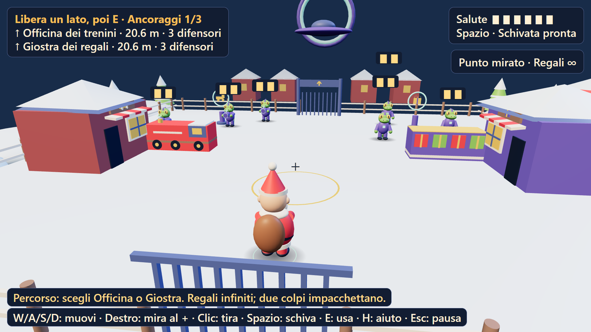

<div align="center">

# 🎅🛸 Operazione Ho Ho UFO

**Il Natale è sotto attacco. Rispedisci gli invasori al mittente.**

Un'avventura action comica in 3D, giocabile nel browser, con Babbo Natale, rettiliani e regali esplosivi.

[**▶ Gioca online**](https://operazione-ho-ho-ufo.vercel.app) · [Comandi](#-comandi) · [Avvio locale](#-avvio-locale) · [Documentazione](#-documentazione)


</div>



*Screenshot reale del gioco: la Via dei giocattoli, con Officina dei trenini e Giostra dei regali.*

## 🎁 Il gioco

Il generale **Squamakk** ha rubato il nucleo natalizio e vuole usarlo per invadere la Terra. Nei panni di Babbo Natale, attraversi un villaggio innevato, liberi la strada dagli invasori e cerchi di riportare il nucleo al suo posto.

Non servono armi convenzionali: i tuoi regali **impacchettano i rettiliani e li rispediscono alla nave**. L'avventura è in terza persona, con movimento, mira, schivata e interazioni guidate. Tono leggero, nessun sangue e una sorpresa natalizia anche per il generale.

### Tre atti, un'unica avventura

| Atto | Ambientazione | Cosa ti aspetta |
|---|---|---|
| **1 · Il cortile** | Laboratorio di Babbo Natale | Tutorial su drone e schivata, sei difensori e il primo ancoraggio da spegnere. |
| **2 · La Via dei giocattoli** | Officina dei trenini e Giostra dei regali | Due arene in ordine libero, tiratori, ripari e altri due ancoraggi indipendenti. |
| **3 · La piazza** | Albero di Natale e nave aliena | Squamakk, attacchi telegrafati e finestre di vulnerabilità; recupero e restituzione del nucleo, poi il finale. |

Il progetto nasce come avventura breve, con obiettivo di durata **10–15 minuti**: è un'intenzione di design, **non una durata misurata o garantita** per chi gioca per la prima volta.

## ✨ Caratteristiche

- **Grafica “Vinile morbido”**: personaggi e scenari da villaggio di giocattoli, costruiti in codice con Three.js. Nessun modello 3D scaricato, Blender o texture esterna necessaria al gioco.
- **Combattimento leggibile**: tacche salute, segnali a terra, indicatori di aggancio e conferme dei colpi; i ripari restano solidi anche quando la camera li rende traslucidi.
- **Aiuto sempre disponibile**: obiettivi persistenti, indicazioni di percorso, spiegazioni delle interazioni non riuscite e suggerimenti dopo periodi senza progresso.
- **Checkpoint e Continua**: progressi indipendenti per arene e ancoraggi; nel boss, i segmenti completati vengono conservati dopo un retry.
- **Opzioni desktop**: sette azioni da tastiera rimappabili, sensibilità del mouse, inversione verticale, campo visivo da 45° a 75°, mira assistita e riduzione del movimento.
- **Audio locale**: due musiche originali, un ambiente e otto effetti, preparati offline e riprodotti come file statici. Dialoghi in italiano solo a testo, senza doppiaggio.
- **Nessun account o backend applicativo**: il gioco non richiede database, chiavi API o servizi di generazione durante la partita.

## 🎮 Comandi

Pensato per **browser desktop con tastiera e mouse**. Smartphone, touch e gamepad non sono supportati come modalità di gioco.

| Comando predefinito | Azione |
|---|---|
| **W · A · S · D** | Muovi Babbo Natale rispetto alla direzione di visuale. |
| **Tasto destro + trascinamento** | Ruota la camera e mira. |
| **Clic sinistro** | Lancia un regalo verso il **+ centrale**, non verso il punto cliccato. |
| **Spazio** | Schiva. |
| **E** | Usa dispositivi e cancelli; raccogli o restituisci il nucleo. |
| **H** | Richiedi un suggerimento. |
| **Esc** | Metti in pausa o riprendi. |
| **Invio** | Salta l'introduzione o la presentazione finale quando disponibile. |

Con la mira assistita attiva, **AGGANCIATO · assistenza** segnala l'aggancio del bersaglio. Disattivandola, il tiro segue il reticolo senza correggere la traiettoria. Le istruzioni mostrano i tasti effettivi dopo una rimappatura.

### Salvataggi e impostazioni

Progressi e preferenze sono conservati nel **localStorage del browser**, non su un server. Browser, dispositivi e indirizzi diversi hanno salvataggi separati: la partita locale non si trasferisce automaticamente al sito Vercel.

- **Continua** riparte dall'ultimo checkpoint registrato, non dall'esatto istante in cui chiudi la pagina.
- **Nuova partita / Nuova avventura** azzera i progressi, ma conserva le impostazioni.
- Le anteprime di M2 e M3 nel menu sono prove separate e non sostituiscono il salvataggio principale.
- La cancellazione dei dati del sito rimuove anche salvataggi e preferenze. Con storage non disponibile, il gioco mostra un avviso.

## 🛠 Stack tecnico

| Area | Tecnologia |
|---|---|
| Linguaggio | TypeScript |
| Rendering e personaggi procedurali | Three.js / WebGL |
| Interfaccia | HTML e CSS, senza framework UI |
| Sviluppo e build | Vite + controllo tipi TypeScript |
| Audio runtime | HTMLAudio, file WAV statici |
| Test e catture | Node.js test runner, Playwright Core, Sharp |
| Hosting | Vercel, build statica da GitHub |

La produzione serve solo il contenuto compilato di `dist/`. Il gioco carica JavaScript e audio dal proprio sito: non dipende da una CDN per Three.js. Le vecchie demo di confronto grafico usano invece una CDN e richiedono Internet.

## 🚀 Avvio locale

### Requisiti

- **Node.js 22.23.1** (ambiente verificato), oppure una release successiva compatibile con Vite e con le API Node usate dai test.
- **npm** e Git per clonare il repository pubblico su GitHub.
- Un browser desktop moderno con **WebGL** abilitato. Chrome o Edge installato è necessario anche per gli strumenti automatici di cattura.

```bash
git clone https://github.com/rosariomoscato/operazione-ho-ho-ufo.git
cd operazione-ho-ho-ufo
npm ci
npm run dev
```

Apri **http://127.0.0.1:5174/**. Non sono necessarie variabili ambiente per eseguire il gioco.

Per provare la build di produzione:

```bash
npm run build
npm run preview
```

Apri **http://127.0.0.1:5175/**. Il comando `build` esegue prima il controllo dei tipi, poi genera `dist/`.

> **Windows / PowerShell:** se `npm.ps1` è bloccato, usa `npm.cmd` al posto di `npm`. Non occorre modificare la execution policy. Se Chrome/Edge non è in una posizione standard, imposta `BROWSER_PATH` per i test browser.

## 🧪 Test e catture

```bash
# Test unitari, regressioni, salvataggi e hash delle copie storiche
npm test

# Verifica byte-per-byte della milestone rifinita congelata
node --test tools/polish-snapshot.test.mjs

# Verifica credits/link e rigenera lo screenshot del README dalla build corrente
npm run build
node tools/check-credits.mjs

# Suite mirate per i due atti successivi
npm run test:street
npm run test:square

# Catture deterministiche, audit UI e rendering software
npm run capture:polish

# Partita automatica con input reali: prima compila il gioco
npm run build
npm run test:playthrough
```

Esempio di cattura singola, con controllo numerico della scena:

```bash
node tools/capture.mjs index.html --build --scenario street-both-active --views player --times 0 --size 1920x1080 --selftest --out captures/manual
```

Le demo espongono `window.LC` per scenari, viste, tempi riproducibili e `selfTest()`. Gli output dei tool vanno in `captures/`; le prove archiviate sono in `docs/evidence/`.

La milestone approvata **polished-1 / TmJx2Hx1** ha superato 45 test comuni, test degli hash, 864 pose camera, 27 fotogrammi di verifica, una partita automatica completa e un playtest indipendente dalla sola interfaccia. Sono **prove di quella build**, non una certificazione automatica di tutte le modifiche successive. I test headless non garantiscono 60 fps sul computer di chi gioca e non misurano la durata umana dell'avventura.

## 🗂 Struttura del progetto

```text
src/
├── game.ts             # Ciclo di gioco, HUD, transizioni e API di debug
├── acts/               # Dati, coordinate e obiettivi dei tre atti
├── levels/             # Costruzione procedurale delle ambientazioni
├── characters/         # Personaggi, rig e animazioni
├── gameplay/           # Combattimento, tiratori e boss
├── engine/             # Camera, collisioni e matematica
├── ui/                 # Comandi e credits condivisi
├── storage.ts          # Checkpoint, migrazioni e preferenze
└── audio.ts            # Mixer dei file audio statici
public/audio/           # WAV e indice degli asset
tools/                  # Test, catture e preparazione audio offline
design/                 # Confronti e riferimenti grafici conservati
snapshots/              # Milestone immutabili del gioco
docs/                   # Design, stato, review e prove
```

### Versioni conservate

Queste copie non vengono ricostruite né sovrascritte dai successivi aggiornamenti:

| Versione | Comando | Indirizzo locale |
|---|---|---|
| Cortile M1 | `npm run snapshot:m1` | http://127.0.0.1:5176/ |
| Via dei giocattoli M2 | `npm run snapshot:m2` | http://127.0.0.1:5177/ |
| Avventura completa, release candidate | `npm run snapshot:release` | http://127.0.0.1:5179/ |
| Avventura rifinita, polished-1 | `npm run snapshot:polish` | http://127.0.0.1:5181/ |

Per i laboratori e i confronti originali: `npm run dev:labs`, poi [laboratorio tecnico](http://127.0.0.1:5173/tools/testscene.html), [stili grafici](http://127.0.0.1:5173/design/styles/index.html) e [ascolto audio](http://127.0.0.1:5173/tools/audio/audition.html).

## 🌐 Pubblicazione

**Gioco online:** https://operazione-ho-ho-ufo.vercel.app

Il [repository pubblico GitHub](https://github.com/rosariomoscato/operazione-ho-ho-ufo) è collegato a Vercel. Il branch di produzione è **`master`**: un push su quel branch avvia automaticamente una nuova pubblicazione.

Configurazione: preset **Vite**, installazione `npm ci`, build `npm run build`, cartella pubblicata **`dist`**. Il gioco non richiede chiavi, database o configurazione di servizi esterni. Il dominio del sito e quelli delle preview mantengono salvataggi distinti.

Procedure, controlli della prima release, limiti e rollback sono documentati in [DEPLOYMENT.md](docs/DEPLOYMENT.md). Le immagini e le pagine in `docs/` sono per il repository, non vengono servite come parte del gioco compilato.

## 📚 Documentazione

- [Design del gioco](docs/GAME_DESIGN.md) e [sceneggiatura](docs/SCRIPT.md)
- [Design system — Vinile morbido](docs/DESIGN_SYSTEM.md)
- [Audio e strumenti offline](docs/AUDIO.md)
- [Stato del progetto e cronologia](docs/HANDOFF.md)
- [Feedback e limiti noti](docs/BACKLOG.md)
- [Review della rifinitura](docs/reviews/polish-final-review.md)
- [Pubblicazione e gestione](docs/DEPLOYMENT.md)

## ❤️ Credits

© 2026 [Rosario Moscato](https://rosmoscato.xyz) - handcrafted by a human, upgraded by agents.

Un progetto guidato dall'uomo, sviluppato e verificato con l'aiuto di agenti AI. I credits sono presenti anche nell'interfaccia del gioco aggiornato, nei menu e al termine dell'avventura. Le copie storiche congelate conservano la loro interfaccia originale.

## 📄 Licenza

Il progetto è distribuito sotto **licenza MIT**: puoi usare, modificare e distribuire il software, anche per scopi commerciali, mantenendo l'avviso di copyright e il testo della licenza. Il software è fornito senza garanzie.

Consulta [LICENSE](LICENSE) per il testo completo. Le dipendenze di terze parti mantengono le rispettive licenze. La licenza del software non modifica le condizioni del piano hosting Vercel utilizzato.
